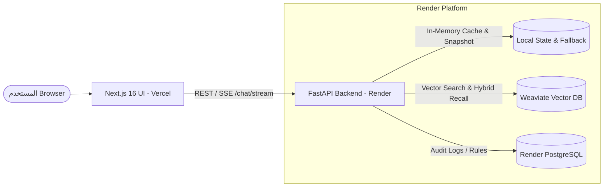

# 🚀 دليل رفع مشروع Mnemos Cognitive Memory AI Engine على Render وإعداد قواعد البيانات

يشرح هذا الدليل بالتفصيل خطوات رفع **الـ Backend (FastAPI)** و**قواعد البيانات (Vector DB & Relational DB)** على منصة **Render**، وربطها مع الـ Frontend المرفوع على **Vercel**.

---

## 🏗️ 1. المعمارية السحابية (Cloud Architecture)



---

## 🗄️ 2. خيارات إعداد الداتا بيز (Database Setup)

المشروع مبني على إطار عمل **CoALA** ويحتاج إلى نوعين من البيانات:
1. **Vector Database (Semantic & Episodic Memory)**: للبحث الدلالي واسترجاع الأوراق البحثية والمحادثات السابقة.
2. **Procedural & Audit Storage**: لحفظ القواعد التشغيلية وسجلات التدقيق.

لديك **3 خيارات معتمدة ومجربة** للـ Vector DB:

### 🟢 الخيار الأول (الموصى به للإنتاج): Weaviate Cloud Service (WCS) - مجاني
أسهل خيار للإنتاج ولا يستهلك موارد السيرفر على Render:
1. اذهب إلى [console.weaviate.cloud](https://console.weaviate.cloud) وسجل حساباً مجانياً.
2. اضغط **"Create Cluster"** واختر الخطة المجانية (**Free Sandbox** صالحة لـ 14 يوماً وقابلة للتجديد بنقرة واحدة).
3. بعد إنشاء الـ Cluster، انسخ:
   - **REST Endpoint**: (مثلاً `https://xxxxxx.weaviate.network`)
   - **API Key** من تبويب `API Keys`.
4. في إعدادات Backend على Render، قم بتعيين المتغيرات:
   - `WEAVIATE_HOST`: رابط الـ Cluster بدون `https://`.
   - `WEAVIATE_PORT`: `443`.
   - `WEAVIATE_API_KEY`: المفتاح الذي نسخته.

---

### 🟡 الخيار الثاني: تشغيل Weaviate على Render مباشرة كـ Docker Service
إذا كنت تفضل بقاء كل شيء داخل Render:
1. في لوحة تحكم Render، اضغط **New +** ثم اختر **Private Service**.
2. اختر **"Deploy an existing image"** وضع رابط الصورة:
   ```text
   cr.weaviate.io/semitechnologies/weaviate:1.27.0
   ```
3. اسم الخدمة: `weaviate-service`.
4. في تبويب **Disks**، اضغط **Add Disk**:
   - الاسم: `weaviate-data`
   - مسار التثبيت (Mount Path): `/var/lib/weaviate`
   - الحجم: 1GB أو أكثر (حسب خطتك).
5. في قسم **Environment Variables**، أضف:
   - `AUTHENTICATION_ANONYMOUS_ACCESS_ENABLED` = `true`
   - `PERSISTENCE_DATA_PATH` = `/var/lib/weaviate`
   - `QUERY_DEFAULTS_LIMIT` = `25`
6. بعد اكتمال التشغيل، انسخ الـ Internal Hostname للخدمة (مثلاً `weaviate-service:8080`).

---

### 🔵 الخيار الثالث: وضع الـ InMemoryFallback التلقائي (صفر تكلفة وصفر إعداد)
المشروع مزود تلقائياً بمحول مرن `InMemoryVectorAdapter`:
- إذا لم يجد السيرفر اتصالاً بـ Weaviate، يعمل فوراً على الذاكرة الداخلية (`RAM`) ويقوم بتحليل كتاب `CoALA_Paper.pdf` وبناء الفهارس تلقائياً دون أي خطأ وبدون الحاجة لإنشاء أي قاعدة بيانات خارجية!

---

### 🐘 إعداد قاعدة بيانات PostgreSQL (اختياري للـ Audit & History)
1. في Render، اضغط **New +** ثم اختر **PostgreSQL**.
2. الاسم: `agentic-memory-db`.
3. اختر الخطة المجانية **Free Tier**.
4. اضغط **Create Database**.
5. انسخ **Internal Database URL** للاستخدام داخل Backend.

---

## 🚀 3. خطوات رفع الـ Backend (FastAPI) على Render

### الطريقة السريعة: استخدام Render Blueprint (ملف `render.yaml`)

لقد قمنا بتجهيز ملف [render.yaml](file:///mnt/work/agentic_memory/render.yaml) الجاهز داخل المشروع:

1. تأكد من عمل `git push` لمشروعك على حسابك في GitHub.
2. اذهب إلى لوحة تحكم [dashboard.render.com](https://dashboard.render.com).
3. اضغط زر **New +** في الزاوية العلوية واختر **Blueprint**.
4. اختر مستودع Git الخاص بك (`agentic_memory`).
5. سيتعرف Render تلقائياً على ملف `render.yaml` ويقوم بإنشاء الخدمة وإعداد أوامر البناء والتشغيل.
6. في حقل `GROQ_API_KEY`، ضع مفتاح Groq الخاص بك.
7. اضغط **Apply** وسيبدأ الرفع فوراً!

---

### الطريقة اليدوية (Step-by-Step Manual Setup):

إذا أردت إنشاء الخدمة يدوياً خطوة بخطوة:

1. **إنشاء خدمة الويب:**
   - من لوحة Render اضغط **New +** ⬅️ **Web Service**.
   - اختر مستودع GitHub الخاص بالمشروع (`Connect a repository`).

2. **بيانات الخدمة الأساسية:**
   - **Name:** `agentic-memory-backend`
   - **Region:** Frankfurt (EU Central) أو Oregon (US West)
   - **Branch:** `main`
   - **Root Directory:** اتركه فارغاً أو `./`
   - **Runtime:** `Python 3`
   - **Build Command:**
     ```bash
     pip install -r requirements.txt
     ```
   - **Start Command:**
     ```bash
     uvicorn backend.app.presentation.main:app --host 0.0.0.0 --port $PORT
     ```
   - **Plan Type:** `Free` (أو `Starter`)

3. **المتغيرات البيئية (Environment Variables):**
   في تبويب **Environment**، أضف المتغيرات التالية:

   | المفتاح (Key) | القيمة (Value) | الوصف |
   | :--- | :--- | :--- |
   | `PYTHON_VERSION` | `3.11.9` | إصدار بايثون |
   | `GROQ_API_KEY` | `gsk_xxxxxx...` | مفتاح Groq LLM API |
   | `model` | `groq:qwen/qwen3.8-27b` | الموديل المستخدم |
   | `WEAVIATE_HOST` | `localhost` (أو رابط WCS) | مضيف قاعدة بيانات Weaviate |
   | `WEAVIATE_PORT` | `8085` (أو `443` في حال WCS) | منفذ Weaviate |
   | `CORS_ORIGINS` | `["https://rapid-geode-upm1g2t.vercel.app","*"]` | الدومينات المسموح لها بالاتصال |

4. **فحص الصحة (Health Check):**
   - افتح **Advanced Settings**.
   - في حقل **Health Check Path**، ضع:
     ```text
     /health
     ```
   - يضمن ذلك عدم تحويل الترافيك للسيرفر إلا بعد اكتمال تشغيل التطبيق بنجاح.

5. **اضغط Deploy Web Service**:
   - سيبدأ Render في تثبيت الحزم من `requirements.txt` وتشغيل خادم Uvicorn.
   - خلال دقيقة إلى دقيقتين ستظهر الحالة: **`Live`**.
   - سيكون لديك رابط السيرفر العام، مثلاً:
     ```text
     https://agentic-memory-backend.onrender.com
     ```

---

## 🔗 4. ربط الـ Frontend (Vercel) بالـ Backend (Render)

الآن بعد تشغيل الـ Backend على Render، قم بربط واجهة المستخدم عليه:

1. اذهب إلى لوحة تحكم Vercel: [vercel.com/dashboard](https://vercel.com/dashboard).
2. اختر مشروعك **`agnticmemory`**.
3. ادخل على **Settings** ⬅️ **Environment Variables**.
4. أضف المتغير التالي:
   - **Key:** `NEXT_PUBLIC_API_URL`
   - **Value:** رابط سيرفر Render (مثال: `https://agentic-memory-backend.onrender.com`)
5. اضغط **Save**، ثم اذهب إلى **Deployments** واضغط **Redeploy**.

---

## 🧪 5. التحقق والاختبار (Verification)

### 1. اختبار نقطة فحص الصحة (Health Check):
```bash
curl -s https://agentic-memory-backend.onrender.com/health | jq .
```
النتيجة المتوقعة:
```json
{
  "status": "healthy",
  "service": "Agentic Memory AI Engine",
  "vector_db_connected": true,
  "vector_db_mode": "Weaviate",
  "llm_connected": true,
  "model": "qwen/qwen3.8-27b"
}
```

### 2. اختبار تصفح الواجهات:
- افتح رابط الواجهة على Vercel: `https://rapid-geode-upm1g2t.vercel.app/chat`.
- أرسل رسالة للذكاء الاصطناعي وتأكد من ظهور تدفق الرسائل (Streaming) وظهور تفاصيل الذاكرة في شريط **Memory Activity**.
- انتقل لصفحة `https://rapid-geode-upm1g2t.vercel.app/memory-graph` وتأكد من تحميل الـ Topology التفاعلي.
- انتقل لصفحة `https://rapid-geode-upm1g2t.vercel.app/guidelines` وتأكد من إمكانية تعديل وحفظ القواعد الإجرائية.
